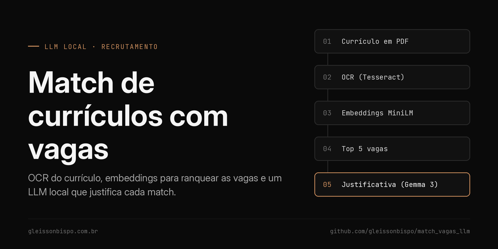
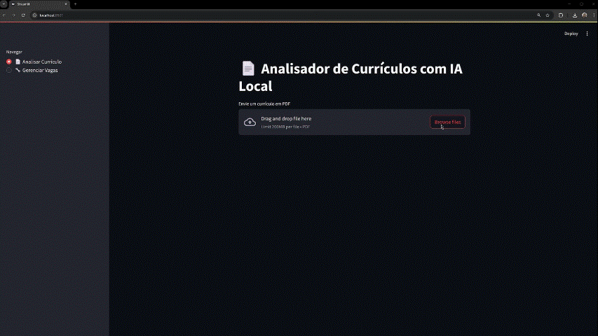
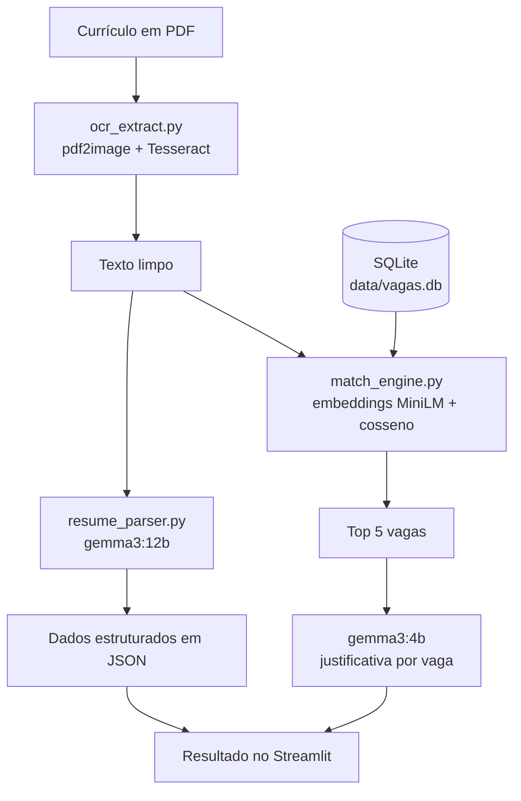

# Match de currículos com vagas usando LLM local

Aplicação em Streamlit que recebe um currículo em PDF, extrai o texto por OCR, estrutura as informações com um LLM local e aponta as cinco vagas mais próximas de um banco de vagas, com uma justificativa escrita para cada uma. Tudo roda na máquina de quem usa.



## Problema

A triagem de currículos consome a maior parte do tempo de quem recruta, e currículo chega em PDF de todo tipo, inclusive escaneado. Busca por palavra-chave perde candidatos que descrevem a mesma experiência com outras palavras. E currículo é dado pessoal: enviar esse conteúdo a uma API externa nem sempre é permitido.

## Solução

O fluxo tem quatro etapas, cada uma em um módulo:

1. **OCR.** O PDF vira imagens a 300 dpi (`pdf2image` + Poppler) e o Tesseract extrai o texto em português. Uma limpeza com regex junta palavras hifenizadas e normaliza quebras de linha.
2. **Extração estruturada.** O `gemma3:12b` devolve em JSON: nome, cargo mais recente, experiências, formação, skills e idiomas.
3. **Ranking semântico.** O texto do currículo e a descrição de cada vaga viram embeddings (`all-MiniLM-L6-v2`). A similaridade de cosseno ordena as vagas e ficam as cinco primeiras.
4. **Justificativa.** Só para essas cinco, o `gemma3:4b` compara currículo e vaga com uma rubrica de 100 pontos (habilidades técnicas, experiência, formação, soft skills e aderência geral) e escreve um parágrafo explicando a nota.

O ranking por embeddings é barato e roda em todas as vagas. O LLM, que é lento, entra só no final. Essa divisão mantém o tempo de resposta aceitável em hardware comum.

O app também tem uma tela para criar, editar e excluir vagas. Na primeira execução o banco é populado com 30 vagas de exemplo (tecnologia, marketing e RH).

## Arquitetura



| Arquivo | Papel |
|---|---|
| `app.py` | Interface Streamlit: análise de currículo e gestão de vagas |
| `ocr_extract.py` | PDF para texto (OCR) e limpeza |
| `resume_parser.py` | Extração dos campos do currículo com LLM |
| `match_engine.py` | Embeddings, ranking e justificativa |
| `db.py` | SQLite: criação, carga inicial e CRUD de vagas |

## Como rodar

### 1. Dependências do sistema

**Tesseract com o idioma português**

```bash
# Debian/Ubuntu
sudo apt install tesseract-ocr tesseract-ocr-por poppler-utils
```

No Windows: instale o Tesseract pelo [instalador da UB Mannheim](https://github.com/UB-Mannheim/tesseract/wiki) marcando o idioma português, baixe o [Poppler para Windows](https://github.com/oschwartz10612/poppler-windows/releases) e adicione as duas pastas `bin` ao PATH.

**Ollama e modelos**

Instale o [Ollama](https://ollama.com) e baixe os dois modelos (cerca de 11 GB no total):

```bash
ollama pull gemma3:12b
ollama pull gemma3:4b
```

### 2. Projeto

```bash
git clone https://github.com/gleissonbispo/match_vagas_llm.git
cd match_vagas_llm
python -m venv .venv && source .venv/bin/activate   # no Windows: .venv\Scripts\activate
pip install -r requirements.txt
streamlit run app.py
```

Rode o comando de dentro da pasta do projeto: o banco é criado em `data/vagas.db`, caminho relativo. Na primeira execução o `sentence-transformers` baixa o modelo de embeddings (cerca de 90 MB).

## Exemplo de uso

1. Abra **Analisar Currículo** e envie um PDF.
2. O app mostra o início do texto extraído e os dados estruturados em JSON.
3. Em seguida aparecem as cinco vagas mais próximas, por exemplo:

```text
Analista de People Analytics — Similaridade: 61%
Score: 70. O currículo traz experiência com Python, SQL e Power BI em análises
de RH, o que atende aos requisitos técnicos. Não há evidência de modelagem de
turnover, ponto central da vaga...
```

4. Em **Gerenciar Vagas**, cadastre as vagas reais da sua empresa para substituir as de exemplo.

Os números acima são ilustrativos. O percentual exibido é a similaridade de cosseno. O score de 0 a 100 vem dentro do texto gerado pelo LLM.

## Limitações

- O embedding é calculado sobre o texto bruto do currículo e só sobre o campo de descrição da vaga. Skills, senioridade e experiência mínima cadastradas não entram no ranking.
- O `all-MiniLM-L6-v2` foi treinado principalmente em inglês e considera só o começo de textos longos. Em currículos extensos em português, parte do conteúdo fica de fora do vetor.
- Os dados estruturados extraídos pelo LLM são exibidos, mas não alimentam o match.
- Os embeddings das vagas são recalculados a cada análise. Com poucas dezenas de vagas isso não pesa; com milhares, pesa.
- Se o modelo devolver um JSON inválido na extração, o app mostra um objeto vazio.
- PDFs escaneados com baixa qualidade degradam o OCR e tudo que vem depois.
- Ferramenta de apoio à triagem. Não foi avaliada quanto a viés e não deve decidir sozinha quem avança num processo seletivo.
- Não há testes automatizados.

## Próximos passos

- Trocar para um modelo de embeddings multilíngue e incluir skills e senioridade no texto da vaga.
- Guardar os embeddings das vagas em um banco vetorial.
- Usar saída estruturada (Pydantic) na extração e na nota do LLM.
- Fazer o caminho inverso: dada uma vaga, ranquear um banco de currículos.
- Montar um conjunto de pares currículo e vaga anotados para medir a qualidade do ranking.

## Privacidade

OCR, embeddings e LLM rodam localmente. Nenhum currículo é enviado a serviços externos. O `.gitignore` bloqueia `*.pdf` para evitar que currículos de teste sejam versionados por engano.

## Autor

**Gleisson Bispo**, Gerente de People Analytics. Escrevo sobre dados de pessoas, Data Science e IA aplicada a RH.

- Site: [gleissonbispo.com.br](https://gleissonbispo.com.br) (projetos, artigos, radar de notícias e vagas de People Analytics)
- Este projeto no site: [gleissonbispo.com.br/projetos/match-curriculo-vagas-llm](https://gleissonbispo.com.br/projetos/match-curriculo-vagas-llm)
- LinkedIn: [linkedin.com/in/gleissonbispo](https://www.linkedin.com/in/gleissonbispo)
- Newsletter: [People Analytics LAB](https://www.linkedin.com/newsletters/people-analytics-lab-7423156507271368704), no LinkedIn
- GitHub: [@gleissonbispo](https://github.com/gleissonbispo)

